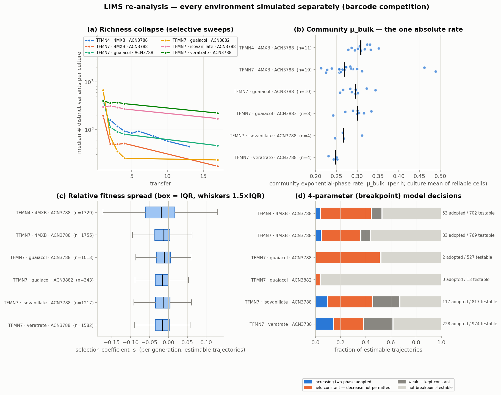
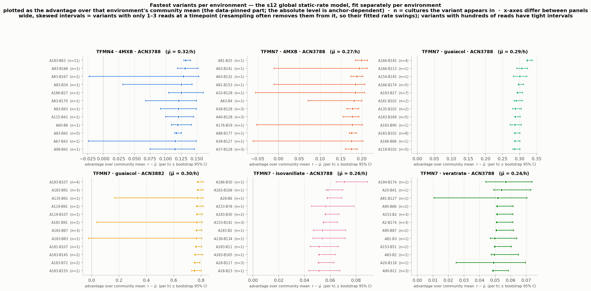
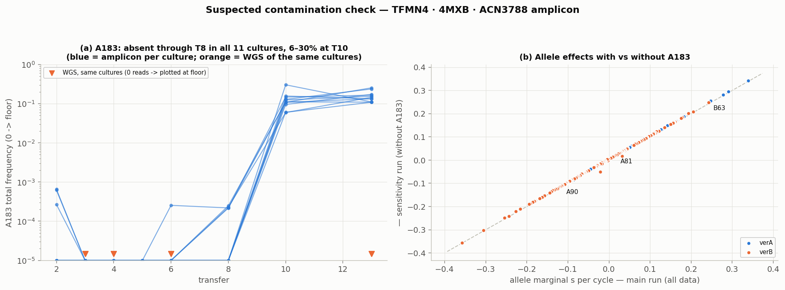
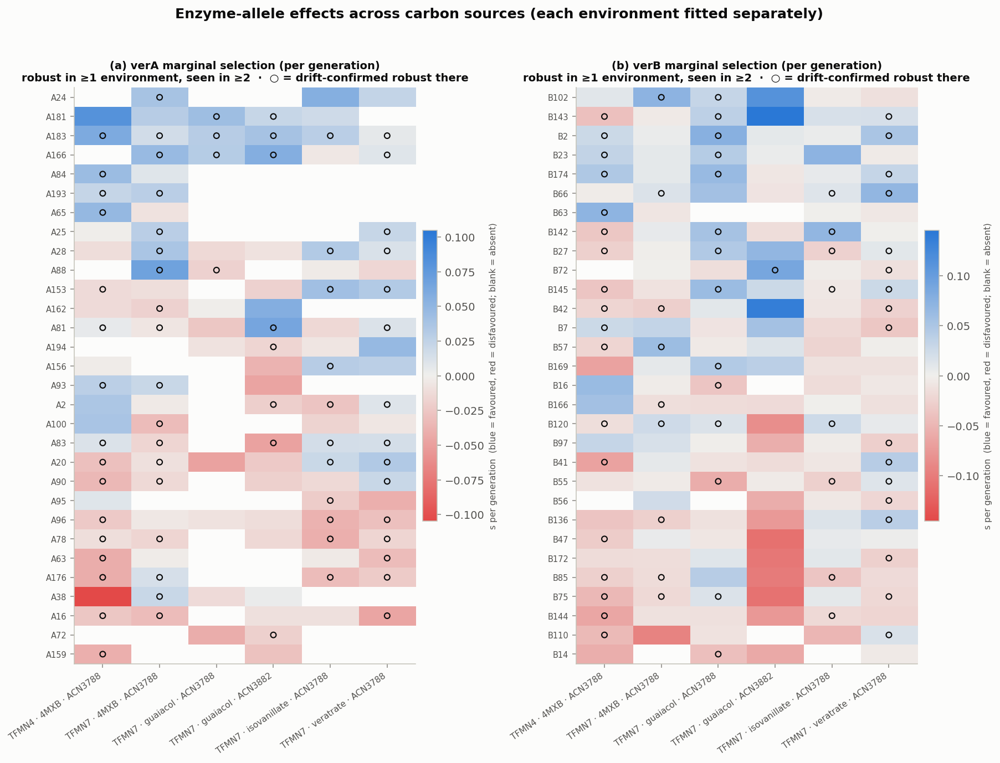
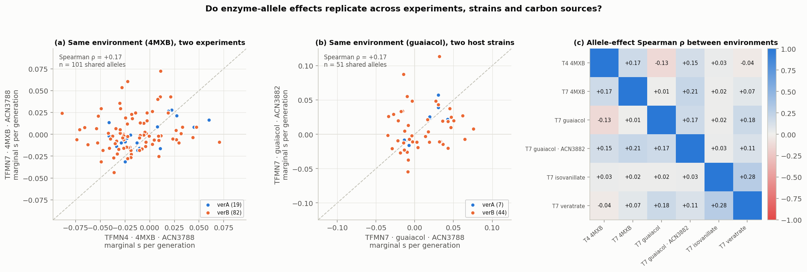
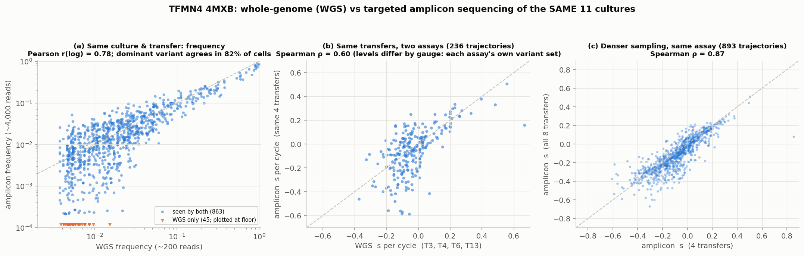
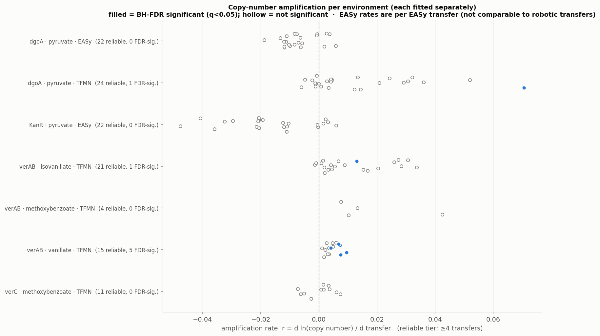

# LIMS mirror re-analysis — every environment simulated separately

_Auto-generated by `scripts/lims_compare.py` from `lims_mirror.backup.db` (445 MB). Interpretation and caveats: [`docs/LIMS_REANALYSIS.md`](../docs/LIMS_REANALYSIS.md)._

## 1. What is in the database

31 tables (every LIMS table keeps soft-deleted row versions; only live rows are used):

| table | rows_live | rows_soft_deleted | role_here |
|---|---|---|---|
| Mutations | 278089 | 82348 | inventoried only (no method in this repo consumes it) |
| Robotic_OD | 235200 | 0 | OD curves (s02, s08) |
| verAB_barcodes | 75624 | 0 | barcode counts (s01) |
| dgoA_alleles | 21824 | 0 | inventoried only (no method in this repo consumes it) |
| dgoA_lib_variants | 5407 | 0 | inventoried only (no method in this repo consumes it) |
| Genes_curated | 3356 | 0 | inventoried only (no method in this repo consumes it) |
| Genes | 3356 | 3367 | inventoried only (no method in this repo consumes it) |
| Library_candidates | 2356 | 0 | inventoried only (no method in this repo consumes it) |
| Copy_numbers | 1810 | 427 | copy-number trajectories (cn01) |
| Measurements | 1616 | 1835 | inventoried only (no method in this repo consumes it) |
| Seq_samples | 1604 | 5606 | inventoried only (no method in this repo consumes it) |
| Samples | 1134 | 1053 | metadata fallback (EASy lineages) |
| Robotic_ALE_samples | 860 | 1478 | culture -> condition / strain / well |
| robotic_mt_samples | 323 | 586 | inventoried only (no method in this repo consumes it) |
| Wells | 96 | 0 | inventoried only (no method in this repo consumes it) |
| Strain_stocks_ANL | 69 | 0 | inventoried only (no method in this repo consumes it) |
| DNA_constructs | 56 | 105 | inventoried only (no method in this repo consumes it) |
| Strains | 48 | 1070 | inventoried only (no method in this repo consumes it) |
| Seq_orders | 42 | 54 | inventoried only (no method in this repo consumes it) |
| Experiments | 24 | 45 | inventoried only (no method in this repo consumes it) |
| Conditions | 24 | 11 | carbon source + concentration |
| Breseq_registry | 20 | 17 | inventoried only (no method in this repo consumes it) |
| Primers | 18 | 0 | inventoried only (no method in this repo consumes it) |
| Measurement_types | 12 | 0 | inventoried only (no method in this repo consumes it) |
| Robotic_run | 10 | 13 | inventoried only (no method in this repo consumes it) |
| dgoA_alleles_new | 10 | 0 | inventoried only (no method in this repo consumes it) |
| Sample_mixtures | 9 | 0 | inventoried only (no method in this repo consumes it) |
| Plasmid_stocks_ANL | 4 | 0 | inventoried only (no method in this repo consumes it) |
| dgoA_alleles_old | 3 | 0 | inventoried only (no method in this repo consumes it) |
| Study | 2 | 0 | inventoried only (no method in this repo consumes it) |
| Transformation_libraries | 2 | 0 | inventoried only (no method in this repo consumes it) |

Barcode sequencing orders (live rows):

| Seqorder | assay | n_seqsamples | n_time_series_seqsamples | reads | frac_reads_unk_allele |
|---|---|---|---|---|---|
| LTA_4MXB_04142026_Bella | amplicon | 33 | 0 | 33 | 0.0% |
| LTA_4MXB_04282026_Bella | amplicon | 41 | 0 | 41 | 0.0% |
| Plasmidsaurus_2026-05_Yusuke | amplicon | 21 | 0 | 41058 | 1.3% |
| Plasmidsaurus_2026-06-25_ZQT7PJ | amplicon | 11 | 11 | 42796 | 2.5% |
| Plasmidsaurus_2026-06-26_KZGC3B | amplicon | 33 | 33 | 140156 | 3.0% |
| Plasmidsaurus_2026-07-09_JF7C2X | amplicon | 37 | 37 | 126377 | 1.4% |
| Plasmidsaurus_2026-07-14_PLYG3T | amplicon | 10 | 10 | 40646 | 1.2% |
| Plasmidsaurus_2026-07_Yusuke | amplicon | 10 | 0 | 53905 | 3.1% |
| Plasmidsaurus_2026-10-09_37MMWP | amplicon | 51 | 51 | 191727 | 4.7% |
| Plasmidsaurus_2026-10-14_4W8GBN | amplicon | 60 | 60 | 232495 | 3.6% |
| Plasmidsaurus_2026-10-15_8WZ9ZS | amplicon | 60 | 60 | 207937 | 3.6% |
| Plasmidsaurus_2026-10-15_XT4RRR | amplicon | 60 | 60 | 203859 | 3.1% |
| Plasmidsaurus_2026-10-23_74TJ9W | amplicon | 47 | 47 | 205966 | 3.0% |
| Plasmidsaurus_2026-10-27_YTZT9N | amplicon | 1 | 1 | 3765 | 24.0% |
| SeqCenter_2026-05-26_QUO1022807 | wgs | 66 | 66 | 10643 | 0.1% |

**Barcode QC.** 436 culture×transfer×order cells. 3 superseded by a deeper re-sequencing of the same cell; 8 below the amplicon depth floor (500 identified reads). 47,814 reads with an un-called allele (A_UNK/B_UNK) dropped (median per-cell share 1.5%); cultures where a half-called lineage exceeds 10% of reads are flagged:

| culture | included | max_frac_reads_unk | top_unk_lineage | max_unk_transfer |
|---|---|---|---|---|
| TFMN7verAB.ACN3788.Mxb.verABLib_sub_2.1 | True | 45% | A88-B_UNK | 3.0 |
| TFMN7verAB.ACN3788.Mxb.verABLib_sub_2.2 | True | 10% | A176-B_UNK | 2.0 |
| TFMN7verAB.ACN3788.Mxb.verABLib_sub_2.3 | True | 20% | A176-B_UNK | 2.0 |
| TFMN7verAB.ACN3788.Mxb.verABLib_sub_4.2 | False | 25% | A162-B_UNK | 3.0 |
| TFMN7verAB.ACN3788.Mxb.verABLib_sub_6.4 | True | 23% | A196-B_UNK | 17.0 |
| TFMN7verAB.ACN3788.Mxb.verABLib_sub_9.1 | False | 99% | A81-B_UNK | 17.0 |
| TFMN7verAB.ACN3882.Gua.verABLib_large.1 | False | 94% | A_UNK-B162 | 4.0 |

**Contamination check (noDNA controls should carry no barcodes):**

| culture | transfer | reads | n_variants | top_variants |
|---|---|---|---|---|
| TFMN7verAB.ACN3788.Iva.noDNA.3 | 4 | 3762 | 12 | A95-B123:3743, A95-B36:7, A196-B174:2 |

**Not modelable with the repo's time-series methods:** 105 seqsamples (isolate genotyping (1 read = the verAB identity of one colony): 74, single end-point selection (no transfer index / no T0): 21, sub-library composition (input pool): 10).

## 2. Environments simulated (one pipeline run each)

| environment | role | n_cultures | transfers | median_depth | n_variants | hours_per_transfer | generations_per_cycle |
|---|---|---|---|---|---|---|---|
| TFMN4 · 4MXB · ACN3788 | new analysis | 11 | 2,3,4,5,6,8,10,13 | 3926 | 1909 | 26.4 | 3.43 |
| TFMN4 · 4MXB · ACN3788 · WGS | validation (same data as the repo's WGS CSV) | 11 | 3,4,6,13 | 190 | 314 | 26.4 | 3.455 |
| TFMN7 · guaiacol · ACN3788 | new analysis | 10 | 1,2,3,4,17 | 4182 | 3100 | 26.7 | 3.06 |
| TFMN7 · guaiacol · ACN3882 | new analysis | 9 | 1,2,3,4,17 | 3766 | 4865 | 26.7 | 3.377 |
| TFMN7 · isovanillate · ACN3788 | new analysis | 4 | 1,2,3,4,17 | 4321 | 1272 | 26.7 | 2.699 |
| TFMN7 · 4MXB · ACN3788 | new analysis | 19 | 1,2,3,4,17 | 4010 | 3178 | 26.7 | 3.204 |
| TFMN7 · veratrate · ACN3788 | new analysis | 4 | 1,2,3,4,17 | 4253 | 1565 | 26.7 | 2.732 |
| TFMN4 · 4MXB · ACN3788 · excl A183 (all partners) | sensitivity: TFMN4_methoxybenzoate_ACN3788_amplicon without A183 (all partners) | 11 | 2,3,4,5,6,8,10,13 | 3830 | 1889 | 26.4 | 3.43 |

## 3. Validation — the DB reproduces the repo

The WGS counts ingested from the DB were run through the same code and compared with the committed `outputs/`: **21/25 output tables identical**. Differences:

| file | status | max_abs_numeric_diff | column_of_max | text_cells_differing |
|---|---|---|---|---|
| global_variant_growth_rates.csv | differs | 0.0718 | ci_boot_lo | 39 |
| model_comparison_summary.csv | differs | 0 |  | 3 |
| model_fit_error.csv | differs | 0 |  | 1 |
| segmented_model_selection.csv | differs | 0 |  | 1 |

Every number is identical except in `global_variant_growth_rates.csv`. There the s12 point estimates `r_global_per_h` and `se_laplace` agree to 0.0001/h (4th-decimal rounding), while the s12b bootstrap / LOSO / OD-weight-sensitivity columns differ by up to 0.072/h (39/314 `identifiability` labels change): the LIMS runs solve those refits to convergence, whereas the committed `outputs/` holds the repo's iteration-capped refits, which are not reproducible across machines anyway (docs/LIMS_REANALYSIS.md §3). 
`model_comparison_summary.csv`, `model_fit_error.csv`, `segmented_model_selection.csv` differ only in free text: the `dataset` label, and the `interpretation` sentences, which LIMS runs generate from their own numbers — on this data they reach the same conclusions the repo states (LOOCV parity once the elbow is learned, a clear gain when it is supplied, a larger optimism gap for the 4-var).

## 4. Barcode results per environment

| environment | richness_first_median | richness_last_median | mu_bulk_median_per_h | n_estimable | s_per_gen_median | s_per_gen_p95 | top_winner_verA | top_winner_verA_wins | n_robust_verA | n_robust_verB |
|---|---|---|---|---|---|---|---|---|---|---|
| TFMN4 · 4MXB · ACN3788 | 159 | 44 | 0.3196 | 1329 | -0.019 | +0.054 | A81 | 6 | 23 | 57 |
| TFMN4 · 4MXB · ACN3788 · WGS | 30 | 9 | 0.318 | 237 | -0.015 | +0.060 | A81 | 6 | 3 | 7 |
| TFMN7 · guaiacol · ACN3788 | 415 | 46 | 0.2941 | 1013 | -0.011 | +0.055 | A183 | 8 | 6 | 43 |
| TFMN7 · guaiacol · ACN3882 | 669 | 23 | 0.3006 | 343 | -0.017 | +0.051 | A183 | 8 | 10 | 10 |
| TFMN7 · isovanillate · ACN3788 | 297 | 170 | 0.2626 | 1217 | -0.014 | +0.039 | A186 | 2 | 14 | 37 |
| TFMN7 · 4MXB · ACN3788 | 195 | 17 | 0.2663 | 1755 | -0.012 | +0.049 | A88 | 4 | 20 | 38 |
| TFMN7 · veratrate · ACN3788 | 400 | 222 | 0.237 | 1582 | -0.017 | +0.035 | A183 | 2 | 18 | 64 |
| TFMN4 · 4MXB · ACN3788 · excl A183 (all partners) | 157 | 41 | 0.3196 | 1312 | -0.018 | +0.055 | A81 | 6 | 22 | 57 |

| environment | top_robust_verA | top_robust_verB | bridge_components | global_fit_freq_R2 | global_fit_OD_rmse_per_h | global_rate_min | global_rate_max |
|---|---|---|---|---|---|---|---|
| TFMN4 · 4MXB · ACN3788 | A183 (+0.060/gen) | B63 (+0.071/gen) | 1 | 0.948 | 0.116 | 0.09 | 0.452 |
| TFMN4 · 4MXB · ACN3788 · WGS | A90 (+0.030/gen) | B3 (+0.078/gen) | 1 | 0.946 | 0.147 | 0.153 | 0.461 |
| TFMN7 · guaiacol · ACN3788 | A181 (+0.043/gen) | B2 (+0.075/gen) | 1 | 0.887 | 0.227 | -0.474 | 0.616 |
| TFMN7 · guaiacol · ACN3882 | A81 (+0.064/gen) | B72 (+0.087/gen) | 1 | 0.797 | 0.525 | -0.241 | 1.078 |
| TFMN7 · isovanillate · ACN3788 | A153 (+0.042/gen) | B142 (+0.069/gen) | 1 | 0.989 | 0.073 | 0.108 | 0.334 |
| TFMN7 · 4MXB · ACN3788 | A88 (+0.068/gen) | B102 (+0.072/gen) | 3 | 0.952 | 0.144 | 0.023 | 0.465 |
| TFMN7 · veratrate · ACN3788 | A20 (+0.033/gen) | B66 (+0.069/gen) | 1 | 0.876 | 0.060 | 0.036 | 0.294 |
| TFMN4 · 4MXB · ACN3788 · excl A183 (all partners) | A65 (+0.049/gen) | B174 (+0.049/gen) | 1 | 0.960 | 0.118 | 0.091 | 0.493 |

_`global_fit_OD_rmse_per_h` = mismatch between the model's community rate and the measured μ_bulk; large values mean the per-hour level of `r_global_per_h` is not OD-anchored — read the rates relative to μ̄ (`rel_advantage_per_h`)._

**4-parameter (breakpoint) model:**

| environment | n_transfers | n_estimable | n_breakpoint_testable | n_two_phase_adopted | n_held_decrease | loocv_ratio_elbow_learned | loocv_4var_better_elbow_learned | loocv_ratio_elbow_supplied |
|---|---|---|---|---|---|---|---|---|
| TFMN4 · 4MXB · ACN3788 | 8 | 1329 | 702 | 53 | 538 | 0.649 | 50/53 | 0.542 |
| TFMN4 · 4MXB · ACN3788 · WGS | 4 | 237 | 66 | 13 | 47 | 0.923 | 7/13 | 0.528 |
| TFMN7 · guaiacol · ACN3788 | 5 | 1013 | 527 | 2 | 520 | 1.47 | 1/2 | 0.356 |
| TFMN7 · guaiacol · ACN3882 | 5 | 343 | 13 | 0 | 13 |  | 0/0 |  |
| TFMN7 · isovanillate · ACN3788 | 5 | 1217 | 817 | 117 | 436 | 0.655 | 87/117 | 0.355 |
| TFMN7 · 4MXB · ACN3788 | 5 | 1755 | 769 | 83 | 549 | 0.507 | 63/83 | 0.417 |
| TFMN7 · veratrate · ACN3788 | 5 | 1582 | 974 | 228 | 376 | 0.597 | 160/228 | 0.421 |
| TFMN4 · 4MXB · ACN3788 · excl A183 (all partners) | 8 | 1312 | 701 | 53 | 537 | 0.634 | 47/53 | 0.542 |

Per-environment folders (tables + the full figure suite of the original pipeline):

- `outputs_lims/barcode/TFMN4_methoxybenzoate_ACN3788_amplicon/` — TFMN4 · 4MXB · ACN3788
- `outputs_lims/barcode/TFMN4_methoxybenzoate_ACN3788_wgs/` — TFMN4 · 4MXB · ACN3788 · WGS
- `outputs_lims/barcode/TFMN7_guaiacol_ACN3788_amplicon/` — TFMN7 · guaiacol · ACN3788
- `outputs_lims/barcode/TFMN7_guaiacol_ACN3882_amplicon/` — TFMN7 · guaiacol · ACN3882
- `outputs_lims/barcode/TFMN7_isovanillate_ACN3788_amplicon/` — TFMN7 · isovanillate · ACN3788
- `outputs_lims/barcode/TFMN7_methoxybenzoate_ACN3788_amplicon/` — TFMN7 · 4MXB · ACN3788
- `outputs_lims/barcode/TFMN7_veratrate_ACN3788_amplicon/` — TFMN7 · veratrate · ACN3788
- `outputs_lims/barcode/TFMN4_methoxybenzoate_ACN3788_amplicon_excl_A183/` — TFMN4 · 4MXB · ACN3788 · excl A183 (all partners)

### 4b. Suspected contamination in TFMN4 · 4MXB · ACN3788: A183 (all partners)

verA A183 is essentially absent from all 11 TFMN4 cultures through T8 (10 reads in 66 culture-transfers, ~260k reads) and from every WGS sample (0 reads, incl. T13), then appears at T10/T13 in all 11 cultures at once - dominated by A183-B63 (6-30% at T10, 11-25% at T13; ~30 WGS reads per culture expected at T13, 0 seen) plus a dozen other A183 pairings at 1-6 reads - and only in the two June 2026 amplicon orders (ZQT7PJ, KZGC3B) -> suspected contamination of the T10/T13 amplicon material by an A183-carrying population.

Systematic cross-assay check (same culture & transfer, both directions; a variant counts as discordant when the lower 95% bound of its frequency in one assay predicts reads in the other but none were seen; Poisson P below a Bonferroni threshold over all tested cells):

| Candidate | n_cells | median_amplicon_freq | wgs_reads |
|---|---|---|---|
| A183-B63 | 11 | 14.5% | 0.0 |

The main run keeps every read; the sensitivity run `outputs_lims/barcode/TFMN4_methoxybenzoate_ACN3788_amplicon_excl_A183/` drops A183 (all partners). What changes:

| metric | value |
|---|---|
| verA_marginal_spearman_main_vs_excl | 0.9995 |
| verA_robust_main | 23 |
| verA_robust_excl | 22 |
| verA_robust_only_in_main | A183 |
| verA_robust_only_in_excl |  |
| verB_marginal_spearman_main_vs_excl | 0.9993 |
| verB_robust_main | 57 |
| verB_robust_excl | 57 |
| verB_robust_only_in_main | B63 |
| verB_robust_only_in_excl | B79 |
| A183_marginal_s_per_cycle_main | +0.206 (robust True); excluded from the sensitivity run |
| A81_marginal_s_per_cycle_main_vs_excl | +0.016 vs +0.021 (robust True vs True) |
| A90_marginal_s_per_cycle_main_vs_excl | -0.116 vs -0.112 (robust True vs True) |
| A78_marginal_s_per_cycle_main_vs_excl | -0.036 vs -0.032 (robust True vs True) |
| global_rel_advantage_spearman_main_vs_excl | 0.9968 |
| global_rel_advantage_max_abs_change_per_h | 0.0422 |
| top12_fastest_overlap | 11/12 |
| n_breakpoint_testable_main_vs_excl | 702 vs 701 |
| n_two_phase_adopted_increasing_main_vs_excl | 53 vs 53 |
| global_fit_freq_R2_main_vs_excl | 0.948 vs 0.960 |

## 5. Across environments

| env_a | env_b | n_shared_alleles | spearman | n_robust_in_both | robust_sign_agreement |
|---|---|---|---|---|---|
| TFMN4 · 4MXB · ACN3788 | TFMN7 · 4MXB · ACN3788 | 101 | +0.17 | 39 | 24 |
| TFMN4 · 4MXB · ACN3788 | TFMN7 · guaiacol · ACN3788 | 81 | -0.13 | 25 | 8 |
| TFMN4 · 4MXB · ACN3788 | TFMN7 · guaiacol · ACN3882 | 40 | +0.15 | 7 | 3 |
| TFMN4 · 4MXB · ACN3788 | TFMN7 · isovanillate · ACN3788 | 92 | +0.03 | 30 | 14 |
| TFMN4 · 4MXB · ACN3788 | TFMN7 · veratrate · ACN3788 | 102 | -0.04 | 46 | 22 |
| TFMN7 · 4MXB · ACN3788 | TFMN7 · guaiacol · ACN3788 | 90 | +0.01 | 16 | 10 |
| TFMN7 · 4MXB · ACN3788 | TFMN7 · guaiacol · ACN3882 | 50 | +0.21 | 7 | 5 |
| TFMN7 · 4MXB · ACN3788 | TFMN7 · isovanillate · ACN3788 | 106 | +0.02 | 22 | 12 |
| TFMN7 · 4MXB · ACN3788 | TFMN7 · veratrate · ACN3788 | 118 | +0.07 | 34 | 21 |
| TFMN7 · guaiacol · ACN3788 | TFMN7 · guaiacol · ACN3882 | 51 | +0.17 | 8 | 7 |
| TFMN7 · guaiacol · ACN3788 | TFMN7 · isovanillate · ACN3788 | 84 | +0.02 | 16 | 8 |
| TFMN7 · guaiacol · ACN3788 | TFMN7 · veratrate · ACN3788 | 105 | +0.18 | 24 | 17 |
| TFMN7 · guaiacol · ACN3882 | TFMN7 · isovanillate · ACN3788 | 44 | +0.03 | 8 | 5 |
| TFMN7 · guaiacol · ACN3882 | TFMN7 · veratrate · ACN3788 | 58 | +0.11 | 10 | 5 |
| TFMN7 · isovanillate · ACN3788 | TFMN7 · veratrate · ACN3788 | 110 | +0.28 | 32 | 24 |

### WGS vs amplicon on the same TFMN4 cultures

- frequency concordance (variants seen by both): Pearson r(log) = 0.78, Spearman = 0.76; 95% of WGS-detected variant×cells are also seen by the amplicon; dominant variant agrees in 82% of 44 cells.
- same transfers (s per cycle on T3/T4/T6/T13): Spearman = 0.60 over 236 trajectories. Absolute levels are NOT comparable across assays (each slope is relative to the geometric mean of the variants that assay detects), so alleles are compared as a difference from the median allele / percentile:

| verA | wgs_4T_minus_median | wgs_4T_percentile | amp_4T_minus_median | amp_4T_percentile | amp_allT_minus_median | amp_allT_percentile |
|---|---|---|---|---|---|---|
| A78 | 0.063 | 0.875 | -0.0006 | 0.5 | -0.1041 | 0.227 |
| A81 | 0.0218 | 0.812 | 0.0189 | 0.538 | -0.0515 | 0.32 |
| A83 | -0.0278 | 0.375 | -0.0513 | 0.192 | -0.0309 | 0.413 |
| A90 | 0.1066 | 0.938 | 0.0481 | 0.596 | -0.1838 | 0.067 |
| A183 |  |  | 0.8597 | 1.0 | 0.1376 | 0.947 |

- estimable trajectories: WGS 237 → amplicon (8 transfers) 1329; amplicon 4- vs 8-transfer slopes Spearman = 0.87.

## 6. Copy-number environments

| environment | n_lineages | n_ci_reliable | n_amplifying_fdr | n_losing_fdr | median_rate_reliable | top_amplifier | n_breakpoint_testable | n_two_phase_adopted | n_decelerating |
|---|---|---|---|---|---|---|---|---|---|
| dgoA · pyruvate · EASy | 22 | 22 | 0 | 0 | -0.0080 |  | 22 | 10 | 10 |
| dgoA · pyruvate · TFMN | 105 | 24 | 1 | 0 | +0.0043 | TFMN1.pgi.1 r=+0.071±0.011 (q=0.019) | 24 | 2 | 20 |
| KanR · pyruvate · EASy | 22 | 22 | 0 | 0 | -0.0159 |  | 22 | 5 | 10 |
| verAB · isovanillate · TFMN | 21 | 21 | 1 | 0 | +0.0067 | TFMN2.ACN3500.Iva.DEL6kb-DELvanK-DELadeK.4 r=+0.013±0.001 (q=0.010) | 21 | 3 | 8 |
| verAB · methoxybenzoate · TFMN | 26 | 4 | 0 | 0 | +0.0117 |  | 4 | 2 | 0 |
| verAB · vanillate · TFMN | 15 | 15 | 5 | 0 | +0.0041 | TFMN2.ACN3500.Van.DEL6kb-DELvanK-DELadeK.1 r=+0.010±0.001 (q=0.016) | 15 | 1 | 7 |
| verC · methoxybenzoate · TFMN | 34 | 11 | 0 | 0 | +0.0015 |  | 11 | 1 | 4 |

- `outputs_lims/copy_number/dgoA_pyruvate_EASy/` — dgoA copy number, Pyruvate 20 mM + Kan (EASy)
- `outputs_lims/copy_number/dgoA_pyruvate_TFMN1-TFMN4exp1/` — dgoA copy number, Pyruvate 20 mM + Kan (TFMN)
- `outputs_lims/copy_number/KanR_pyruvate_EASy/` — KanR copy number, Pyruvate 20 mM + Kan (EASy)
- `outputs_lims/copy_number/verAB_isovanillate_TFMN2/` — verAB copy number, Isovanillate 3 mM + Kan (TFMN)
- `outputs_lims/copy_number/verAB_methoxybenzoate_TFMN2-TFMN3/` — verAB copy number, Methoxybenzoate 3 mM + Kan (TFMN)
- `outputs_lims/copy_number/verAB_vanillate_TFMN2/` — verAB copy number, Vanillate 3 mM + Kan (TFMN)
- `outputs_lims/copy_number/verC_methoxybenzoate_TFMN4exp2/` — verC copy number, Methoxybenzoate 4 mM + Kan (TFMN)

